# 04 Database Design (ERD)

## Business Management System

| Status | Draft 1.0 |
|---|---|
| Date | 2026-11-24 |
| Requirements | [PRD](./prd.md) |
| Technical rules | [TRD](./trd.md) |
| Architecture | [System architecture](./system-architecture.md) |

This logical model is a starting point for Django models and PostgreSQL migrations. Individual transactions may be denominated in LRD or USD concurrently; this organization's reporting base currency is USD. The owner selected an owner/admin-entered daily FX rate and moving weighted-average inventory costing as provisional settings; the accountant must approve the rate source/effective-time rule and financial/accounting details.

The provider/messaging entities shown below are a future-release design only and MUST NOT be included in the MVP schema. MVP payment records are manual entries made after funds are received outside the application.

## 1. Entity relationship diagram

```mermaid
erDiagram
    ORGANIZATION ||--o{ BUSINESS_SECTION : contains
    ORGANIZATION ||--o{ BRANCH : operates
    ORGANIZATION ||--o{ MEMBERSHIP : grants_access
    ORGANIZATION ||--o{ EXCHANGE_RATE : approves
    ORGANIZATION ||--o{ PROVIDER_ACCOUNT : configures
    EXCHANGE_RATE ||--o{ SALE : snapshots
    EXCHANGE_RATE ||--o{ PURCHASE : snapshots
    EXCHANGE_RATE ||--o{ CUSTOMER_PAYMENT : snapshots
    EXCHANGE_RATE ||--o{ SUPPLIER_PAYMENT : snapshots
    EXCHANGE_RATE ||--o{ EXPENSE : snapshots
    EXCHANGE_RATE ||--o{ CUSTOM_ORDER : snapshots
    USER ||--o{ MEMBERSHIP : has
    ROLE ||--o{ MEMBERSHIP : assigned
    ROLE ||--o{ ROLE_PERMISSION : grants
    PERMISSION ||--o{ ROLE_PERMISSION : included

    ORGANIZATION ||--o{ CUSTOMER : owns
    ORGANIZATION ||--o{ SUPPLIER : owns
    ORGANIZATION ||--o{ PRODUCT : catalogs
    PRODUCT ||--o{ PRODUCT_VARIANT : has
    PRODUCT_VARIANT ||--o{ STOCK_BALANCE : measured_at
    BRANCH ||--o{ STOCK_BALANCE : holds
    PRODUCT_VARIANT ||--o{ STOCK_MOVEMENT : moves
    BRANCH ||--o{ STOCK_MOVEMENT : movement_at

    CUSTOMER ||--o{ SALE : places
    BUSINESS_SECTION ||--o{ SALE : records_for
    BRANCH ||--o{ SALE : records_at
    SALE ||--|{ SALE_LINE : contains
    PRODUCT ||--o{ SALE_LINE : sold_as
    PRODUCT_VARIANT o|--o{ SALE_LINE : variant
    SALE_LINE ||--o{ STOCK_MOVEMENT : issues

    SUPPLIER ||--o{ PURCHASE : supplies
    PURCHASE ||--|{ PURCHASE_LINE : contains
    PRODUCT_VARIANT ||--o{ PURCHASE_LINE : ordered
    PURCHASE ||--o{ GOODS_RECEIPT : received_by
    GOODS_RECEIPT ||--|{ GOODS_RECEIPT_LINE : contains
    PURCHASE_LINE ||--o{ GOODS_RECEIPT_LINE : received_against
    GOODS_RECEIPT_LINE ||--o{ STOCK_MOVEMENT : adds
    STOCK_ADJUSTMENT ||--o{ STOCK_MOVEMENT : corrects
    PRODUCT_VARIANT ||--o{ STOCK_ADJUSTMENT : adjusted

    SALE ||--o{ CUSTOMER_PAYMENT_ALLOCATION : paid_by
    CUSTOMER_PAYMENT ||--o{ CUSTOMER_PAYMENT_ALLOCATION : allocates
    CUSTOMER ||--o{ CUSTOMER_PAYMENT : pays
    SALE ||--o{ PAYMENT_INTENT : collects
    PAYMENT_INTENT ||--o{ PROVIDER_PAYMENT_EVENT : receives
    PAYMENT_INTENT ||--o| CUSTOMER_PAYMENT : settles
    PURCHASE ||--o{ SUPPLIER_PAYMENT_ALLOCATION : paid_by
    SUPPLIER_PAYMENT ||--o{ SUPPLIER_PAYMENT_ALLOCATION : allocates
    SUPPLIER ||--o{ SUPPLIER_PAYMENT : receives

    ORGANIZATION ||--o{ EXPENSE : records
    EXPENSE_CATEGORY ||--o{ EXPENSE : classifies
    BUSINESS_SECTION ||--o{ EXPENSE : belongs_to

    CUSTOMER ||--o{ CUSTOM_ORDER : requests
    BUSINESS_SECTION ||--o{ CUSTOM_ORDER : fulfills
    BRANCH ||--o{ CUSTOM_ORDER : assigned_at
    CUSTOM_ORDER ||--o| PHOTOGRAPHY_DETAIL : photography
    CUSTOM_ORDER ||--o| PRINTING_DETAIL : printing
    CUSTOM_ORDER ||--o| CLOTHING_DETAIL : clothing
    CUSTOM_ORDER ||--o{ CUSTOMER_PAYMENT_ALLOCATION : paid_by
    CUSTOM_ORDER ||--o{ ORDER_STATUS_EVENT : changes
    CUSTOM_ORDER ||--o{ PAYMENT_INTENT : collects

    CUSTOMER ||--o{ MESSAGE_CONSENT : controls
    CUSTOMER ||--o{ MESSAGE_OUTBOX : receives
    MESSAGE_OUTBOX ||--o{ MESSAGE_DELIVERY : attempts
    PROVIDER_ACCOUNT ||--o{ MESSAGE_DELIVERY : sends
    PROVIDER_ACCOUNT ||--o{ PAYMENT_INTENT : processes

    ORGANIZATION ||--o{ AUDIT_EVENT : audits
    USER ||--o{ AUDIT_EVENT : performs
    ORGANIZATION ||--o{ NOTIFICATION : alerts
    USER ||--o{ NOTIFICATION : receives
    ORGANIZATION ||--o{ ATTACHMENT : stores
```

## 2. Core entity definitions

All records are organization-scoped unless noted. Primary keys use UUIDs. Timestamps are UTC. Money fields use PostgreSQL `NUMERIC` and Django `DecimalField`; quantity precision is configured for whole or fractional units as required.

| Entity | Important fields | Constraints and notes |
|---|---|---|
| `Organization` | `id`, `name`, `base_currency` (`USD` for this organization), `timezone`, `tax_settings`, `created_at` | USD is the confirmed base currency; country/time zone/tax configuration is confirmed or approved before production. |
| `ExchangeRate` | `organization_id`, `source_currency`, `base_currency`, `rate_to_base`, `effective_at`, `source`, `approved_by`, `created_at` | Stores approved base units per one source-currency unit; immutable once used by a posted transaction. |
| `ProviderAccount` | `organization_id`, `provider`, `channel`, `enabled`, `supported_methods`, `supported_currencies`, `secret_reference`, `status` | Stores non-secret configuration and secret-manager reference only; merchant onboarding/verification state is audited. |
| `BusinessSection` | `id`, `organization_id`, `name`, `code`, `active` | Unique `(organization_id, code)`; seed Clothing, Printing, Photography. |
| `Branch` | `id`, `organization_id`, `name`, `code`, `timezone`, `active` | Unique `(organization_id, code)`; independent stock/numbering policy is open. |
| `Membership` | `user_id`, `organization_id`, `role_id`, `branch_scope`, `section_scope`, `active` | Unique `(user_id, organization_id)` unless multiple role assignments are explicitly modeled. |
| `Role` / `Permission` | `name`, `code`, `scope`; role-permission join | Built-in roles are defaults, not hard-coded authorization checks. |
| `Customer` | `organization_id`, `name`, `phone`, `address`, `customer_type`, `notes`, `active` | Contact data is access-controlled; do not store unnecessary sensitive data. |
| `Supplier` | `organization_id`, `name`, `phone`, `location`, `notes`, `active` | Supplier history and balances are derived from purchases/payments. |
| `Product` | `organization_id`, `section_id`, `category_id`, `name`, `sku`, `kind`, `tracks_stock`, `buying_price_base`, `selling_price_base`, `minimum_stock`, `status` | Organization-scoped SKU uniqueness; catalog prices use the selected base currency; services have `tracks_stock=false`. |
| `ProductVariant` | `product_id`, `code`, `size`, `color`, `active` | Use a default variant for stock-tracked products without options; SKU/variant uniqueness defined per organization. |
| `StockBalance` | `variant_id`, `branch_id`, `quantity_on_hand`, `average_unit_cost_base`, `updated_at` | Unique `(variant_id, branch_id)`; cost is normalized to organization base currency; treat as a locked cache reconciled to movements. |
| `StockMovement` | `variant_id`, `branch_id`, `quantity_delta`, `unit_cost_base`, `movement_type`, `source_kind`, `source_id`, `actor_id`, `created_at` | Immutable; positive/negative delta and reason required. Source relationship validated by domain service. |
| `Sale` | `organization_id`, `section_id`, `branch_id`, `customer_id?`, `number`, `status`, `currency`, `fx_rate_to_base`, `fx_rate_id?`, `subtotal`, `discount_total`, `tax_total`, `total`, `base_total`, `posted_at`, `created_by` | Unique `(organization_id, number)`; posted totals and FX snapshot are immutable except by reversal. |
| `SaleLine` | `sale_id`, `product_id`, `variant_id?`, `description_snapshot`, `quantity`, `unit_price`, `discount`, `cost_snapshot_base`, `line_total` | Snapshot product description and price/cost at posting time; base cost supports gross-profit reporting. |
| `CustomerPayment` | `organization_id`, `customer_id`, `amount`, `currency`, `fx_rate_to_base`, `base_amount`, `method`, `reference`, `paid_at`, `recorded_by`, `status`, `payment_intent_id?` | Positive amount; payment record is immutable after posting; cross-currency allocation requires an explicit conversion snapshot. |
| `CustomerPaymentAllocation` | `payment_id`, `sale_id?`, `custom_order_id?`, `amount` | Exactly one target per allocation; sum allocated cannot exceed payment. Unallocated credit policy is to be approved. |
| `Purchase` / `PurchaseLine` | supplier, branch, reference, status, currency, `fx_rate_to_base`, `base_total`, ordered qty, unit cost, extra costs, `reversed_by_id?` | Unique supplier reference policy to be agreed; costs are snapshotted. Drafts may be edited; posted/received purchases use audited reversals. |
| `GoodsReceipt` / `GoodsReceiptLine` | purchase, receipt date/reference, received qty, purchase-line link, actor | Supports partial receipts; duplicate/idempotency protection required. |
| `SupplierPayment` / `SupplierPaymentAllocation` | supplier, amount, currency, FX snapshot, base amount, method, date; allocation to purchase | Same positive amount, immutable history, and allocation-total rules as customer payments. |
| `StockAdjustment` | `variant_id`, `branch_id`, `reason`, `quantity_delta`, `approved_by`, `created_by`, `created_at` | Reason mandatory; sensitive adjustment permissions; creates linked stock movement. |
| `ExpenseCategory` / `Expense` | category name; section, branch, amount, currency, FX snapshot, base amount, date, method, description, recorder, `reversed_by_id?` | Amount positive; optional attachment; posted expense corrections use audited reversal records. |
| `CustomOrder` | organization, section, branch, customer, number, status, price/cost, currency, FX snapshot, base total/cost, due date, assigned staff, created_by | Unique `(organization_id, number)`; stores shared commercial and workflow fields. |
| `PhotographyDetail` | order_id, shoot_type, package, shoot_at, photographer_id, delivery_status, notes | One-to-one with a Photography `CustomOrder`. |
| `PrintingDetail` | order_id, service/product, quantity, size, design, production_cost, status | One-to-one with a Printing `CustomOrder`. |
| `ClothingDetail` | order_id, product, size, color, quantity, design, custom_name, custom_number, production_cost, status | One-to-one with a Clothing `CustomOrder`. |
| `OrderStatusEvent` | order_id, from_status, to_status, actor_id, note, created_at | Append-only status history. |
| `Attachment` | organization_id, storage_key, content_type, file_size, purpose, owner_type/id, uploaded_by | Private storage; owner access checked by application; file type/size allowlisted. |
| `AuditEvent` | organization_id, actor_id?, action, entity_type/id, safe_change_summary, request_id, created_at | Append-only; never include secrets or unrestricted customer data. |
| `Notification` | organization_id, recipient_id, kind, source_type/id, created_at, read_at | In-app MVP; authorization checked when opening linked record. |
| `PaymentIntent` | organization_id, sale_id?/custom_order_id?, provider_account_id, method, amount, currency, status, idempotency_key, provider_reference, checkout_url, created_at | Exactly one customer obligation target; secret credentials are not stored here; status starts pending. |
| `ProviderPaymentEvent` | payment_intent_id, provider_event_id, event_type, received_at, verified_at, safe_payload_hash, processing_status | Provider event ID is unique per provider; verified and processed idempotently; raw secrets/payment data are not retained. |
| `MessageConsent` | customer_id, channel, status, consent_source, consented_at, revoked_at | Consent and suppression tracked per communication channel with actor/source where applicable. |
| `MessageOutbox` | organization_id, customer_id, channel, template, source_type/id, locale, status, created_at | Created transactionally with business event; dispatch only if consent/preferences permit. |
| `MessageDelivery` | outbox_id, provider_account_id, provider_message_id, attempt, state, sent_at, delivered_at, failure_code | Tracks retries and delivery status without logging message secrets. |

## 3. Data integrity, indexes, and lifecycle

- Use `PROTECT`/restrictive deletion for posted transaction relationships. Deactivate catalog and user records instead of deleting referenced history.
- Add database checks for positive payment amounts, valid quantities, valid status values, and exactly-one-target payment allocations.
- Validate currency codes against the allowed LRD/USD set; store immutable per-transaction FX rate/date/source and both transaction-currency and base-currency totals.
- FX rate values must be positive. Once referenced by a posted record, an exchange-rate row cannot be edited; corrections use a new rate record.
- In a future integration release, provider event IDs must be unique within their provider; duplicate callbacks must never create duplicate payments or allocations.
- Future provider-account secrets must be referenced from an external secret store; store only a non-sensitive reference and provider health/onboarding state.
- Before future automated message dispatch, consent/suppression must be checked at send time, not only when the outbox item is created.
- Keep derived balances calculable from posted source records and allocations; any cached summary must be rebuildable.
- Enforce tenant and branch scope through both querysets and service functions. Add tests that attempt cross-organization references.
- Lock the relevant `StockBalance` rows during posting/receipt/adjustment. Use a single database transaction for all coupled updates.
- Index `(organization_id, created_at)`, `(organization_id, status)`, customer/supplier references, SKU, invoice/order numbers, due dates, and `(variant_id, branch_id)`.
- Consider partial indexes for active products and outstanding balances after measuring query patterns.
- Posted records are not hard-deleted. Reversals and corrective events retain a link to the original event and the reason.
- Database migrations must be reversible where feasible and tested against staging snapshots or representative generated data.

## 4. Open schema decisions

1. Owner/admin daily rate entry is selected provisionally. Confirm the approved FX source/effective-time rule, currency scale, tax representation, rounding mode, and whether tax-inclusive pricing is required; USD is the selected reporting base.
2. Branch-level inventory and whether inventory can be shared or transferred between branches.
3. Product option modeling for sizes/colors and support for fractional quantities.
4. Invoice and order numbering format, reset period, branch prefix, and concurrency-safe allocation.
5. Whether a customer payment may be unallocated credit and how cross-currency allocations, refunds, and overpayments work.
6. Approved inventory cost method, FX gains/losses, provider-fee treatment, and landed-cost allocation policy.
7. For a later integration release, payment/messaging providers available in Liberia, event retention, consent capture, templates, and attachment limits. These are not MVP schema gates.
