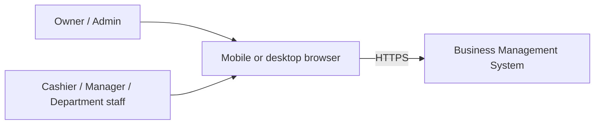
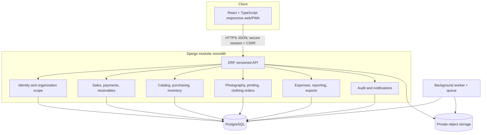

# 03 System Architecture

## Business Management System

| Status | Draft 1.0 |
|---|---|
| Date | 2026-11-24 |
| Requirements | [PRD](./prd.md) |
| Technical constraints | [TRD](./trd.md) |
| Related designs | [ERD](./database-design-erd.md), [API specification](./api-specification.md), [UI/UX flows](./user-flows-ui-ux.md) |

## 1. Architecture goals

- Deliver a secure, reliable MVP with a small operational footprint.
- Keep money, stock, and audit changes transactional and attributable.
- Separate business domains in code while allowing authorized combined reporting.
- Support phone and desktop browsers without maintaining separate native clients.
- Keep core financial workflows provider-independent. Live payment and messaging integrations are deferred to a later release.

## 2. System context



The application is the system of record for operational transactions. MVP staff manually record payments collected through cash, mobile money, bank, or card outside the application. Receipts can be printed, downloaded, or manually shared. No live payment or automated messaging provider is connected in MVP.

## 3. Container architecture



Payment and messaging adapters, outbox records, and provider callbacks are future-release components and are intentionally absent from the MVP container view.

## 4. Deployment view

```text
Business-owned domain
        |
        v
TLS termination / managed ingress
        |
        +--> Static React assets (CDN or app host)
        |
        +--> Django/DRF application runtime
                  |              |
                  v              v
           Managed PostgreSQL   Private object storage
                  |
                  v
           Encrypted backups
        Django runtime --> Worker + queue (large exports, if needed)
```

- Prefer same-origin frontend/API deployment to simplify cookie security and CSRF controls. If separate origins are necessary, use a strict CORS allowlist.
- Use separate development, staging, and production environments and distinct credentials.
- Keep secrets in provider-managed secret storage. Infrastructure and deployment configuration belong in version control without secret values.
- Hosting vendor, region, database tier, high-availability options, and object-storage provider are procurement decisions.
- Use a worker and queue for large exports only if needed. Provider messages and payment-event processing/reconciliation are deferred.
- Provider credentials are secret-manager values/references, never stored as plaintext in PostgreSQL or source control.

## 5. Modular monolith boundaries

| Module | Owns | Key interfaces |
|---|---|---|
| Identity & organization | Users, memberships, roles, permissions, sections, branches | Current-user context, permission checks |
| Customers & suppliers | Shared profiles and scoped contact details | Customer/supplier search and history |
| Catalog | Products, variants, categories, price snapshots | Search, product state |
| Inventory & purchasing | Stock balances, movement ledger, purchases, receipts, supplier obligations | Receive, adjust, issue stock |
| Sales & payments | Sales, invoice lines, manually recorded customer payments/allocations, FX snapshots, reversals | Preview/post sale, apply manual payment, reverse |
| Department orders | Shared order plus photography/printing/clothing detail | Create order, transition status |
| Expenses | Expense categories, expenses, evidence attachments | Record expense |
| Currency & FX | LRD/USD currency selection, approved rates, immutable transaction snapshots | Resolve transaction rate, report base-currency value |
| Future provider integrations | Payment intents/events, message outbox/delivery | Later release only: start checkout, verify callbacks, send/reconcile messages |
| Reporting | Authorized base-currency dashboard aggregates and exports | Filtered summary/report with original currency and FX basis |
| Audit & notifications | Append-only events and in-app alerts; consent/preferences and message delivery are future scope | Record events and retrieve alerts; later, dispatch/reconcile external messages |

Modules share PostgreSQL but own their validation/service layer. Financial or stock side effects must be invoked explicitly by domain services; do not hide them in model signals. Cross-module operations use a single database transaction when atomicity is required.

## 6. Critical sequences

### Sale posting

1. Authenticate user and resolve organization, section, and branch.
2. Authorize sale creation and verify all referenced records are in scope.
3. Recalculate prices, discount, tax (if configured), and payment allocation server-side.
4. Lock affected stock rows and validate availability for stock-tracked variants.
5. In one database transaction create the posted sale, immutable line snapshots, payment/allocation, stock movements, and audit event.
6. Commit; return sale reference, totals, balance, and receipt resource.
7. If any validation or database step fails, roll back all changes and return an actionable error.

### Future release — external payment collection (not MVP)

1. The authenticated client requests a payment intent for a posted invoice/order and an allowed method/currency.
2. The backend validates scope, due balance, provider capability, transaction currency, and amount; it creates a pending local payment intent and idempotency reference.
3. A provider adapter creates a hosted checkout/payment request. The client receives only the provider checkout URL or approved next action.
4. The provider sends an authenticated, signed callback to the backend. The backend verifies signature/timestamp, persists the event idempotently, and queues final state processing.
5. A verified success callback settles the local payment and allocates it once; failures leave a retryable/failed payment state. Browser redirects are display-only and never authoritative.

### Future release — outbound messages (not MVP)

1. A business event (receipt, consented payment reminder, or order update) creates an outbox item within the same database transaction.
2. The worker checks customer consent/preferences, message template, provider configuration, and retry policy.
3. Provider response/message ID and delivery state are persisted. Failures are visible to authorized staff and do not roll back the original sale/order.

### Purchase receiving

1. Authorize receipt and validate the purchase and received quantities.
2. Lock stock balances; reject duplicate or over-receipt unless the purchase policy permits it.
3. In one transaction record receipt lines, stock movements, balance updates, and audit event.
4. Repeated requests with the same idempotency key return the original result rather than duplicating stock.

### Customer/supplier payment

Validate the amount and target balances; record the payment and allocations; recalculate derived balances; audit the action in one transaction. Refunds or corrections use linked reversals rather than modifying prior payment history.

## 7. Security and trust boundaries

- Browser-to-application and application-to-storage traffic uses TLS.
- Authentication uses secure, HttpOnly, SameSite cookies with CSRF protection for the same-origin browser design; long-lived tokens are not stored in local storage.
- Organization/branch scope is enforced in API querysets and domain services, not only in the UI.
- Private file access is authorized and time-limited; file type/size are validated.
- Financial and inventory operations are default-deny and permission-checked server-side.
- Provider callbacks, if added later, must be authenticated with provider-specific signatures and replay protection; redirects must never be authoritative settlement signals.
- Exchange rates and amounts are snapshotted at posting; base currency is locked after the first posted transaction unless an audited migration is approved.
- Audit events omit passwords, authentication tokens, and unnecessary sensitive values.
- Backups are encrypted and access-controlled; restore permissions are restricted to designated operators.

## 8. Key architecture decisions

| Decision | Proposed choice | Rationale / status |
|---|---|---|
| Application shape | Modular monolith | Simplest reliable operating model for one product and modest user scale; proposed. |
| Web client | React + TypeScript responsive PWA | Reuses one interface across phone and desktop browsers; no native/offline guarantee. |
| Backend | Django + DRF | Explicit user requirement and mature server-side authorization/data tooling. |
| Persistence | PostgreSQL | Relational constraints and transactional integrity fit financial and stock workflows. |
| Tenancy | One location; shared customer/supplier records; section-scoped catalog/stock and filterable reports | Matches the owner's confirmed initial setup; branch expansion can be added later. |
| Financial history | Posted records plus compensating reversals | Preserves auditability; detailed accounting policy requires accountant approval. |
| Files | Private object storage | Separates uploaded media from relational transaction records. |
| External services | No payment or messaging providers in MVP; adapters may be added later | Manual payment records and print/download/manual receipt sharing support launch without unverified provider dependencies. |
| Currency reporting | Concurrent LRD/USD transaction currencies; USD reporting base; owner/admin enters a daily rate | Preserves original amounts and supports consistent combined reporting; accountant approval of rate source/effective-time rule is pending; USD is locked after first posting. |

## 9. Operational quality targets

The targets and test approach are defined in the [PRD](./prd.md) and [TRD](./trd.md): 25 concurrent users initially, 100,000 records per organization, p95 interactive searches within two seconds, dashboard within three seconds, RPO ≤ 24 hours, RTO ≤ 8 business hours, and restore validation before launch and quarterly.

## 10. Risks and unresolved decisions

- Confirm country-specific tax/invoice rules, currency precision, and accountant approval of the owner/admin-entered daily FX rate source/effective-time rule before finalizing transaction schema; USD is the selected reporting base.
- Confirm if branches have independent stock, numbering, time zones, and reporting permissions.
- Confirm accountant approval of the selected moving weighted-average inventory cost and the landed-cost, return, and deposit-recognition policies.
- Confirm Liberia hosting availability; if unavailable, obtain owner approval for a nearby supported region. Select storage based on data residency, backup retention, support, and recurring budget.
- Before a later integration release, select payment and messaging vendors and verify merchant eligibility, LRD/USD capability, callback security, sender/template approval, delivery/settlement reporting, and fees.
- Define the import/reconciliation approach for existing customers, products, balances, and opening stock.
- Configure and monitor worker/queue capacity for large exports. Provider callbacks and message delivery are future-release concerns.
