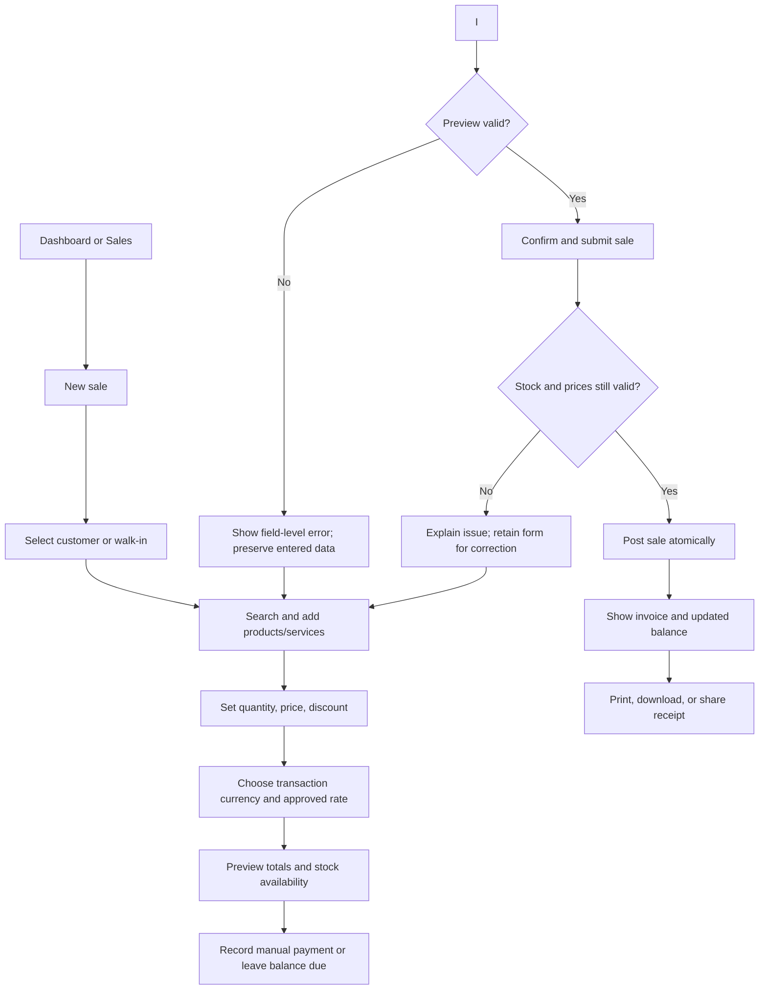
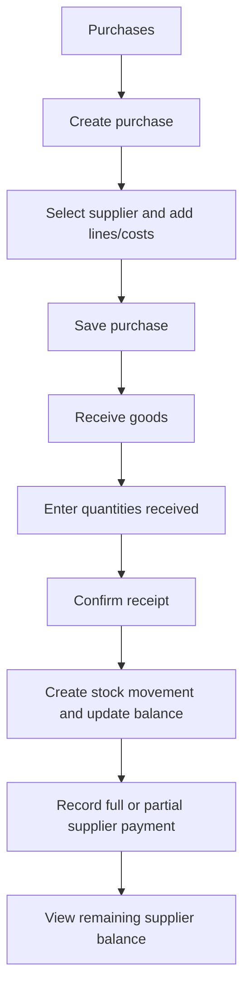
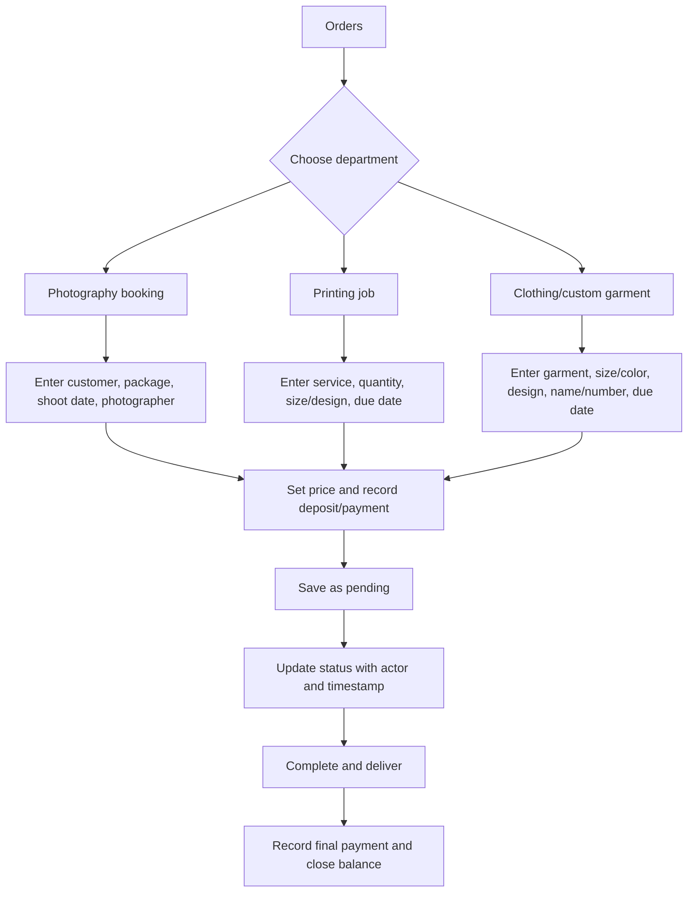
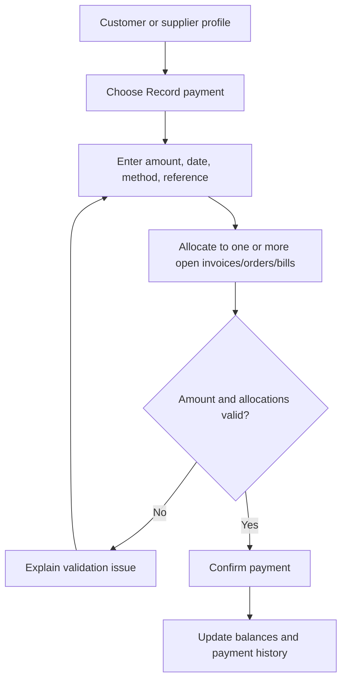
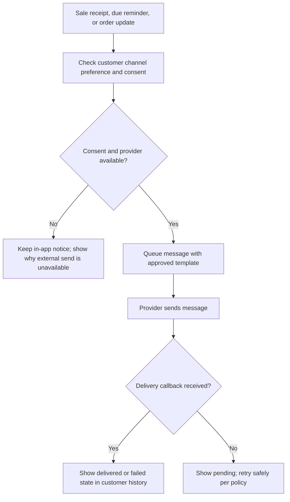

# 02 User Flows & UI/UX Specification

## Business Management System

| Status | Draft 1.0 |
|---|---|
| Date | 2026-11-24 |
| Product requirements | [PRD](./prd.md) |
| Technical requirements | [TRD](./trd.md) |

## 1. UX objectives

- Make frequent cashier, inventory, and order tasks usable on a phone with minimal training.
- Keep financial totals, payment status, business section, and branch visible where mistakes are costly.
- Reduce data entry through searchable selections, sensible defaults, and clear validation.
- Use explicit review and confirmation before posting financial, inventory, or irreversible changes.
- Keep business-specific work (clothing, printing, photography) understandable without hiding shared customer and payment information.

## 2. Navigation and screen inventory

### Global application shell

- **Top bar:** organization/business-section selector, branch selector (when applicable), global search, notification indicator, current user menu.
- **Desktop navigation:** Dashboard; Sales; Orders; Inventory; Purchases; Expenses; Customers; Suppliers; Reports; Staff & Settings.
- **Mobile navigation:** bottom navigation for Dashboard, Sales, Orders, and More; More opens the remaining permission-allowed sections.
- **Persistent context:** show the active section/branch and currency on transaction forms and reports. Changing section must not silently change a form already in progress.
- **Permission behavior:** hide unavailable navigation actions, but always enforce permissions at the API boundary.

### Screen inventory

| Screen | Main content and actions | Primary users |
|---|---|---|
| Sign in / password reset | Individual account access and recovery | All |
| Dashboard | KPIs, period/section/branch filters, alerts, recent transactions | Owner, manager |
| New sale / sale detail | Item search, customer, quantities, discounts, LRD/USD selection, payment, post, receipt | Cashier |
| Sales list | Search, filters, payment status, invoice detail/reversal (permission-gated) | Cashier, manager |
| Products / product detail | Catalog, variants, stock, price, supplier, threshold, movement history | Inventory staff, manager |
| Purchase create / receive | Supplier, items/costs, partial receipt, payment, reference | Inventory staff |
| Stock adjustment | Count/damage/loss/return, reason, before/after quantity, confirmation | Inventory staff, manager |
| Expense list / form | Category, description, amount, date, method, photo/receipt | Authorized staff |
| Customer / supplier detail | Contact information, history, balances, payment timeline | Authorized staff |
| Orders list / order detail | Department filters, owner, due date, payment balance, status history | Department staff |
| Photography booking | Package, shoot date, photographer, customer, payment, delivery | Photographer |
| Printing order | Item/service, quantity, size/design, cost/price, due date, production status | Printing staff |
| Clothing order | Garment, size/color, quantity, design, custom text/number, deposit/status | Clothing staff |
| Payments | Record and allocate customer/supplier payments received outside the system | Cashier, manager |
| Reports | Period and scope filters, summaries, detailed rows, PDF/spreadsheet download | Owner, manager |
| Staff & roles | Invite/deactivate users, assign roles and section/branch scope | Admin |
| Settings | Organization, business sections, branches, currency, time zone, receipt settings | Admin |

## 3. Core user flows

### 3.1 Record a sale and issue a receipt

**Interaction rules**

- Product search supports SKU, name, and variant; display on-hand quantity when stock is tracked.
- Currency is chosen per transaction, not through an organization-wide mode. Staff can record LRD and USD transactions concurrently; the selector shows the approved rate, transaction amount, and USD equivalent before confirmation. Staff cannot silently edit the rate unless explicitly authorized.
- Totals are recalculated by the server before posting. The client must not be trusted for final totals.
- The preview is non-persistent and does not reserve stock; posting revalidates everything to handle concurrent sales.
- MVP records payments received outside the system; it does not initiate online checkout or confirm provider payments.
- Use a review state before posting; prevent duplicate submission while the request is in flight.
- If posting fails because stock changed, retain the form and explain which line needs attention.
- Receipt actions are available after successful posting; receipt content includes organization details, invoice reference, date/time, items, totals, paid amount, and balance.

### 3.2 Receive a purchase and update stock

Ordered and received quantities are distinct. A purchase can be received in multiple batches; retrying the same receipt must not increase stock twice.

### 3.3 Create and fulfill a department order

Printing statuses: Pending → Designing → Production → Completed → Delivered. Other departments use a configured, department-appropriate status list; all status changes are permission-checked and retained in history.

### 3.4 Record a customer or supplier payment

### 3.5 Review dashboard, alerts, and reports

1. Select date range, business section, and optional branch.
2. Review totals with labels distinguishing sales from cash collected, purchases from expenses, and gross from net profit.
3. Open an alert to reach the specific low-stock item, outstanding balance, or due order.
4. Open a report, inspect its filters and period, then download PDF or spreadsheet output.

### 3.6 Future release: send and track customer communications (not MVP)

## 4. Interaction, state, and content patterns

- Every data screen has loading, empty, error, and success states; empty states explain the next action.
- Forms use visible labels, required-field indicators, sensible defaults, inline field errors, and a summary for multi-field failures.
- Preserve entered values after recoverable failures. Never display success when a save/post fails.
- Confirm sale posting, payment posting, reversals, stock adjustments, account deactivation, and other high-impact actions.
- Use explicit statuses with both text and visual treatment; never rely on color alone.
- Show date/time in the configured local time zone while retaining server timestamps.
- When a financial record is denominated in a currency different from the reporting base, show both values and the applied exchange rate with its effective time.
- For mixed-currency reports, show LRD and USD subtotals separately alongside the consolidated USD total; never add unlike currency values without conversion.
- Clearly mark draft versus posted records and distinguish editable drafts from immutable posted transactions.
- Search results and dropdowns must respect the current organization, section, branch, and user permissions.
- Any destructive action must state the affected record and whether it is reversible.

## 5. Responsive and accessibility requirements

- Design for narrow mobile screens from 360 CSS px upward, tablets, and desktop widths; core tasks must not require horizontal scrolling.
- Keep primary actions in reachable touch areas; target at least 44×44 CSS px for major touch controls.
- Use semantic headings, visible keyboard focus, accessible names, form labels, sufficient contrast, and screen-reader announcements for async results/errors.
- Support keyboard-only use for core forms and tables. Keep logical tab order and return focus after dialogs close.
- Target WCAG 2.2 AA for core workflows. Validate with automated checks plus keyboard and screen-reader spot checks.
- Respect reduced-motion preferences. No workflow depends on animation.

## 6. Visual direction (proposed)

- Clear, calm, high-contrast business interface; prioritize legibility and operational status over decorative elements.
- Use a consistent spacing scale, typography hierarchy, and reusable components for forms, tables, badges, cards, dialogs, and date filters.
- Establish design tokens for colors, spacing, radius, elevation, focus, and status. Status color meanings must be consistent and include text labels.
- Keep branding, logo, and accent color configurable after the owner supplies brand assets; do not assume a final palette before review.

## 7. Usability acceptance checks

- A new cashier can complete a sale and issue a receipt in under two minutes after brief onboarding.
- A user can search for an invoice/order by its reference in under ten seconds.
- A staff member can identify the active business section, branch, and payment status before confirming a transaction.
- A recoverable validation or network failure does not silently discard the user's form values.
- Each core flow is tested at mobile and desktop widths and with keyboard navigation.

## 8. Open UX decisions

- Final branding, language(s), locale-specific date/number formatting, and receipt layout.
- Owner/admin enters a daily FX rate; accountant must confirm the approved source and effective-time rule. USD is the confirmed reporting base currency.
- Whether cashier checkout should support a walk-in customer without creating a customer profile.
- Whether all department orders share a status model or each business requires further custom states.
- Preferred customer data visibility for cashiers and department staff.
- Future payment/email/SMS/WhatsApp vendors, message templates, consent capture, and delivery retry rules; these are not MVP decisions.
